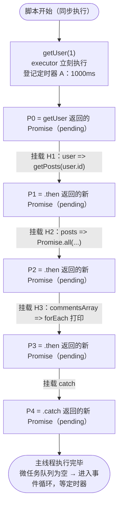
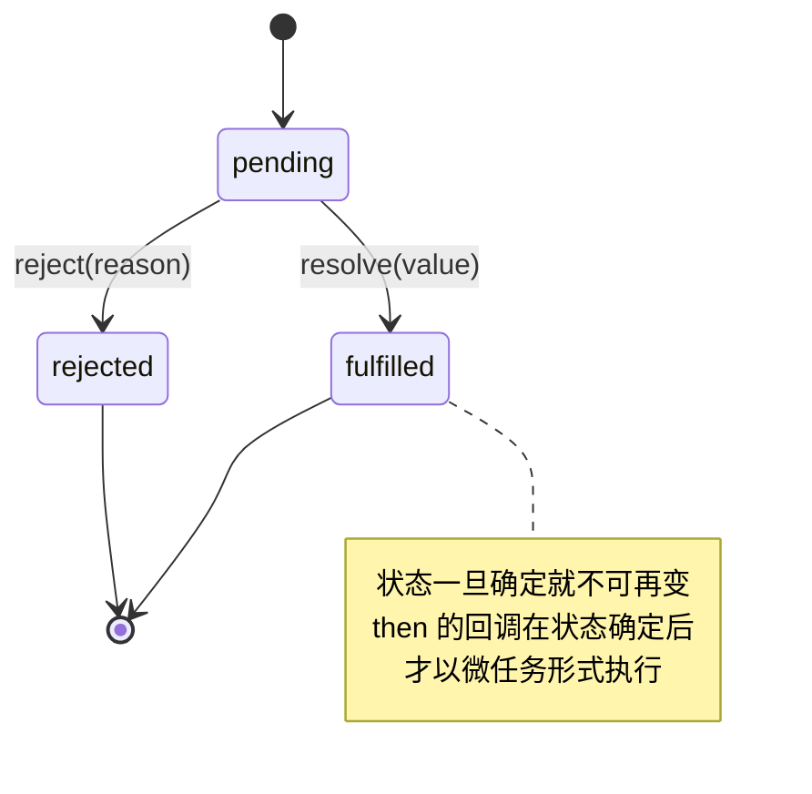
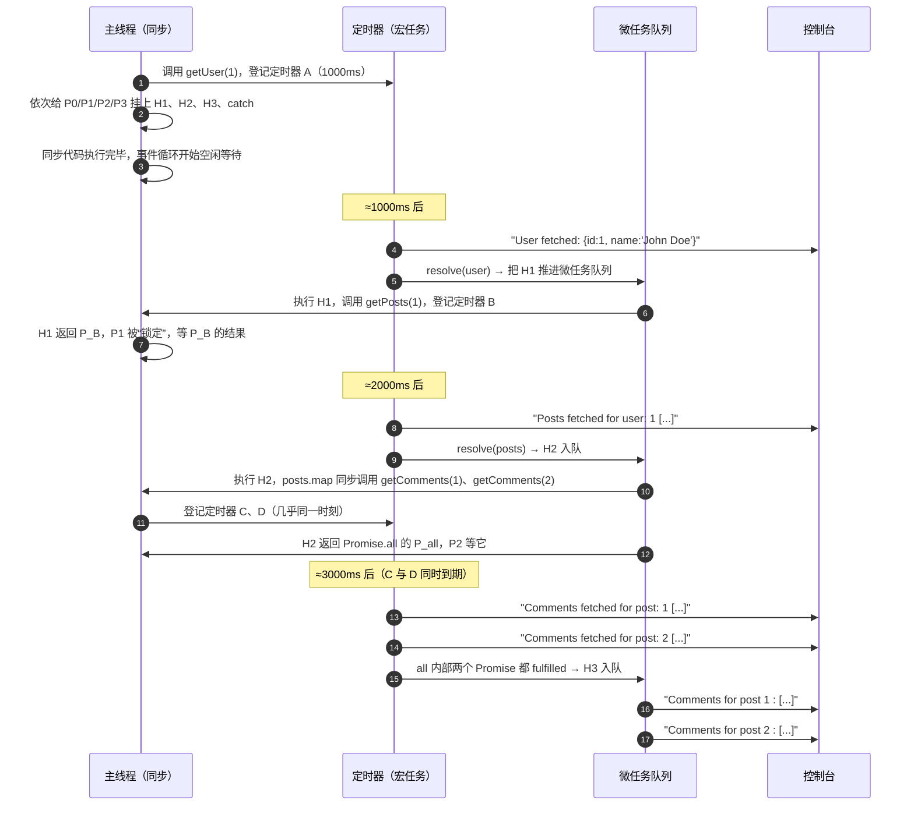

# Promise 链式调用与 Promise.all 流程图解

> **一句话总结**：每一个 `.then()` 都返回一个**新的** Promise，所以「下一步做什么」被写成**返回值**而不是嵌套回调；`getUser → getPosts` 两段串行（1s + 1s），`getComments` 两条**并行**（1s），总耗时 ≈ **3s**，而不是 4s。

---

## 目录

- [[#1. 原始代码|1. 原始代码]]
- [[#2. 结构图：链是怎么搭起来的|2. 结构图：链是怎么搭起来的]]
- [[#3. 时序图：定时器、微任务与主线程|3. 时序图：定时器、微任务与主线程]]
- [[#4. 时间线（实测输出）|4. 时间线（实测输出）]]
- [[#5. 逐帧执行解析|5. 逐帧执行解析]]
- [[#6. 五个关键机制|6. 五个关键机制]]
- [[#7. 串行 vs 并行|7. 串行 vs 并行]]
- [[#8. 常见坑|8. 常见坑]]
- [[#9. 改写为 async/await|9. 改写为 async/await]]

---

## 1. 原始代码

```javascript
// 将每个异步函数改为返回 Promise
function getUser(userId) {
  return new Promise((resolve) => {
    setTimeout(() => {
      const user = { id: userId, name: "John Doe" };
      console.log("User fetched:", user);
      resolve(user);
    }, 1000);
  });
}

function getPosts(userId) {
  return new Promise((resolve) => {
    setTimeout(() => {
      const posts = [{ id: 1, title: "Post 1" }, { id: 2, title: "Post 2" }];
      console.log("Posts fetched for user:", userId, posts);
      resolve(posts);
    }, 1000);
  });
}

function getComments(postId) {
  return new Promise((resolve) => {
    setTimeout(() => {
      const comments = [{ id: 1, text: "Great post!" }, { id: 2, text: "Nice work!" }];
      console.log("Comments fetched for post:", postId, comments);
      resolve(comments);
    }, 1000);
  });
}

// 使用 Promise 链式调用处理异步操作
getUser(1)
  .then(user => getPosts(user.id))
  .then(posts => {
    // 对每个 post 获取评论，返回一个 Promise 数组
    const commentPromises = posts.map(post => getComments(post.id));
    // 使用 Promise.all 等待所有评论获取完成
    return Promise.all(commentPromises);
  })
  .then(commentsArray => {
    // commentsArray 是一个数组，每个元素是对应 post 的评论
    commentsArray.forEach((comments, index) => {
      console.log("Comments for post", index + 1, ":", comments);
    });
  })
  .catch(error => {
    console.error("Error:", error);
  });
```

---

## 2. 结构图：链是怎么搭起来的

关键点：**整条链在同步阶段就一次性建好了**，`getUser(1)` 立刻返回 pending 的 Promise，后面的 `.then` 只是在它上面「挂回调」，不会阻塞主线程。



> [!note] 注意
> 此刻**三个 setTimeout 只登记了 A**（B、C、D 还没创建）。因为 `getPosts` 和 `getComments` 此刻**还没被调用**——它们要等上游 resolve 后，才在 `.then` 回调里被调用。

### Promise 状态机



---

## 3. 时序图：定时器、微任务与主线程



> [!important] 为什么 `console.log` 总是先于该 Promise 的 `.then` 回调？
> `resolve()` 只是把状态置为 fulfilled 并把回调**塞进微任务队列**，当前这段同步代码（这里是定时器回调）会先跑完。因此「User fetched」打印在前，「getPosts 被调用」发生在之后。

---

## 4. 时间线（实测输出）

Node 实测（带时间戳）：

```text
[1012ms] User fetched: {"id":1,"name":"John Doe"}
[2020ms] Posts fetched for user: 1 [{"id":1,"title":"Post 1"},{"id":2,"title":"Post 2"}]
[3031ms] Comments fetched for post: 1 [{"id":1,"text":"Great post!"},{"id":2,"text":"Nice work!"}]
[3031ms] Comments fetched for post: 2 [{"id":1,"text":"Great post!"},{"id":2,"text":"Nice work!"}]
[3031ms] Comments for post 1 : [...]
[3031ms] Comments for post 2 : [...]
```

| 时刻 | 发生了什么 | 控制台输出 |
| --- | --- | --- |
| 0ms | 同步建链：登记定时器 A，挂 H1/H2/H3/catch | — |
| ≈1000ms | 定时器 A 触发 → 打印 → `resolve(user)` → H1 进微任务 | `User fetched:` |
| ≈1000ms+ | 微任务 H1：调用 `getPosts(1)`，登记定时器 B（新的 1000ms） | — |
| ≈2000ms | 定时器 B 触发 → 打印 → `resolve(posts)` → H2 进微任务 | `Posts fetched for user: 1` |
| ≈2000ms+ | 微任务 H2：`map` 同步发起 2 个 `getComments`，登记 C、D | — |
| ≈3000ms | C、D 同时触发（各 1000ms，并行） | `Comments fetched for post: 1 / 2` |
| ≈3000ms+ | `Promise.all` 的内部计数归零 → resolve 数组 → H3 | `Comments for post 1 / 2` |

**总耗时约 3s**：`1s（用户）+ 1s（帖子）+ 1s（评论并行）`。

> [!tip] 若把「取两条评论」写成串行（先 await 完 post1 再取 post2），总耗时会变成 **4s**。

---

## 5. 逐帧执行解析

**第 0 帧（同步阶段，t ≈ 0）**

1. `new Promise(executor)` 中的 executor **同步执行**，所以 `setTimeout` 在调用 `getUser(1)` 的那一刻就被登记；定时器 A 开始计时。
2. `getUser` 返回 P0（pending）。随后四次 `.then` / `.catch` 依次执行：**它们都立即返回新的 pending Promise**，并把回调登记到「上游 Promise 的回调列表」中。
3. 脚本结束，调用栈清空，微任务队列为空，事件循环开始等待。

**第 1 帧（t ≈ 1000ms，定时器 A）**

4. 回调执行：`console.log("User fetched:", user)` → `resolve(user)`。
5. `resolve` 使 P0 → fulfilled，并把 H1 放入**微任务队列**。
6. 本轮宏任务结束后，微任务队列被清空：执行 H1，调用 `getPosts(1)`。此时定时器 B 才被登记（它的 1000ms 从**这一刻**开始算）。
7. H1 返回 P_B（pending）→ **P1 被「锁定（locked）」**：P1 不再接受别的值，等 P_B settle 后，把 P_B 的值原样转交给 P1。

**第 2 帧（t ≈ 2000ms，定时器 B）**

8. 打印 posts → `resolve(posts)` → P_B fulfilled → H2 入微任务队列 → 执行 H2。
9. `posts.map(post => getComments(post.id))`：`map` 是**同步**的，两次 `getComments` 被**连续调用**，定时器 C、D 同时（相差不到 1ms）开始计时 → 二者真正并行。
10. `Promise.all([P_C, P_D])` 返回 P_all（pending），H2 返回它 → P2 被锁定、等 P_all。
11. P_all 内部：每个子 Promise 都挂了「成功 +1 / 失败立即 reject」的回调；计数到 2 时用**输入顺序**的数组 resolve。

**第 3 帧（t ≈ 3000ms，定时器 C、D）**

12. C 触发：打印 post 1 的评论 → `resolve` → 微任务里先清一次队列（此时 P_all 计数 1/2，仍在 pending）。
13. D 触发：打印 post 2 的评论 → `resolve` → 计数 2/2 → P_all fulfilled → H3 入队。
14. H3 执行 `forEach`：打印 `Comments for post 1 / 2`。注意输出的是**数组**（每条 post 对应一组评论），所以是「评论的数组的数组」`[[...],[...]]`。
15. 整条链完成，`catch` 未被触发，P4 fulfilled。

---

## 6. 五个关键机制

| 机制 | 说明 |
| --- | --- |
| **executor 同步执行** | `new Promise(fn)` 里 `fn` 立刻跑，只有 `resolve` 之后的回调才是异步的。定时器在**函数被调用时**就登记，不是被 `.then` 时。 |
| **`.then` 返回新 Promise** | 所以能 `.then().then()`。链式调用的本质是「上游成功 → 执行回调 → **回调的返回值**决定下一个 Promise 的结果」。 |
| **返回 Promise 会被「解包」** | `user => getPosts(user.id)` 返回的是一个 Promise，而非普通值；P1 会**采纳（adopt）**它的状态和值，因此 `posts` 拿到的是数组而不是 Promise 对象。 |
| **微任务优先级** | `resolve` 后回调进微任务队列，**在当前宏任务（这里是定时器回调）结束后立刻清空**，所以打印顺序总是「先 log，后 then」。 |
| **Promise.all 语义** | **并行**发起、**按输入顺序**返回数组（与谁先完成无关）、**快速失败**（任一 reject 立即 reject，其余结果被丢弃）。 |

> [!warning] `.catch` 放在最后能兜住全部
> 因为每个 `.then` 的返回值构成一条链，链上**任何一环**抛错/返回 rejected Promise，都会沿着链向后传播，最终落到最后一个 `.catch`。但反过来，`.catch` **之后**的链段不会再被它捕获——`catch` 也必须 `return` 才能继续往下传。

---

## 7. 串行 vs 并行

```text
串行（本代码的前两段 + 后一段）：getUser → getPosts → getComments(1) → getComments(2) = 4s
实际代码（评论并行）        ：getUser → getPosts ─┬→ getComments(1) ┐
                                              └→ getComments(2) ┴→ 汇总 = 3s
```

- 有**数据依赖**的步骤（`user.id` 才能查 posts）只能串行；
- **互相独立**的步骤（两条 post 的评论）用 `Promise.all` 并行，耗时取**最慢的那一个**。

---

## 8. 常见坑

```javascript
// ❌ 忘了 return：下一个 then 拿到的是 undefined
getUser(1).then(user => { getPosts(user.id); });

// ❌ forEach + async 不会被等待，打印时数组还是空的
posts.forEach(async p => { results.push(await getComments(p.id)); });

// ✅ 正确写法：用 map 收集 Promise，再 Promise.all
const results = await Promise.all(posts.map(p => getComments(p.id)));

// ❌ Promise.all 一失败全失败；想拿到全部结果用 allSettled
const settled = await Promise.allSettled(promises);

// ❌ 没有 catch（或链末没有 catch）→ UnhandledPromiseRejection
```

> [!note] 本代码本身没有错误分支
> 三个函数只会 `resolve`，所以 `.catch` 实际上永远不会执行——它是「防御性代码」，用来兜住未来可能出现的 `reject`、网络错误或 `then` 回调里抛出的异常。

---

## 9. 改写为 async/await

```javascript
async function main() {
  try {
    const user = await getUser(1);
    const posts = await getPosts(user.id);

    // 并行取评论
    const commentsArray = await Promise.all(
      posts.map(post => getComments(post.id))
    );

    commentsArray.forEach((comments, index) => {
      console.log("Comments for post", index + 1, ":", comments);
    });
  } catch (error) {
    console.error("Error:", error);
  }
}

main();
```

`await` 只是 `.then` 的语法糖：**执行时机、微任务调度、耗时完全相同**，只是把「链」写成了「看起来同步」的直线，可读性更好。

---

## 相关笔记

- [[回调地狱（Callback hell）]]
- [[JavaScript 中 Promise.resolve 与 Promise.reject 的参数处理差异]]
