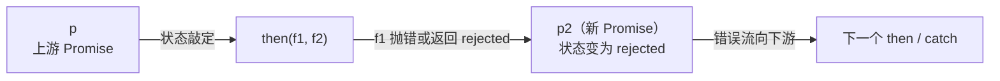
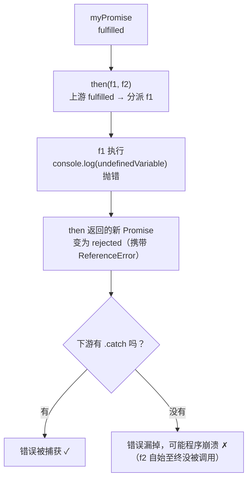
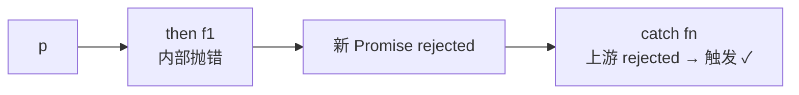
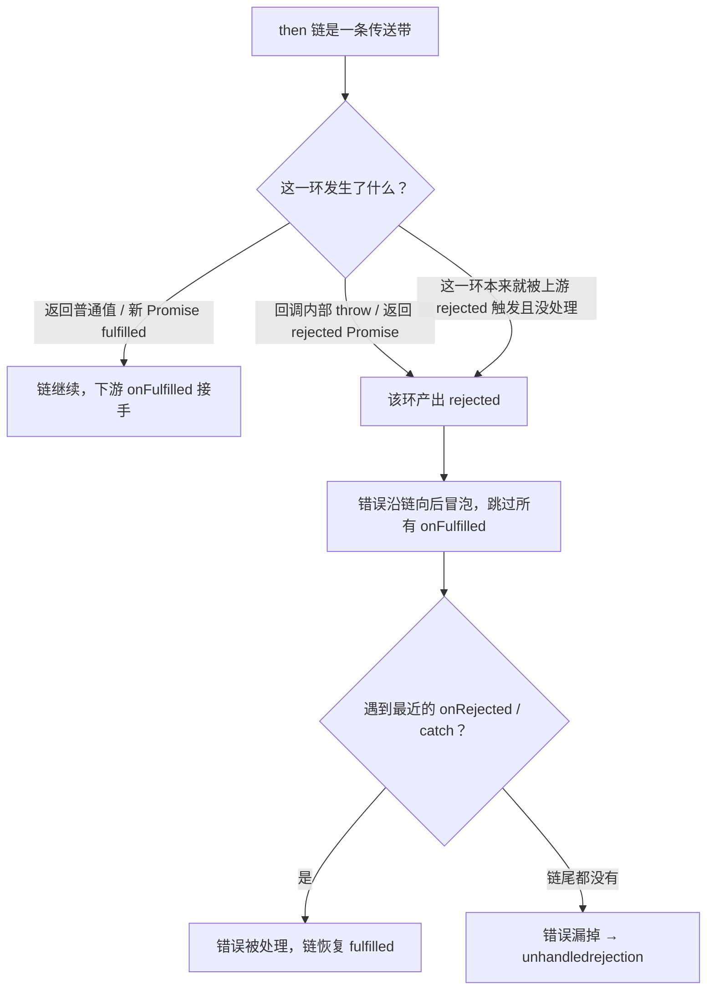

# then 的第二个参数与 catch 的区别——失败回调的捕获陷阱

> **一句话总结**：`then(onFulfilled, onRejected)` 的第二个参数**只负责上游 Promise 本身的 Rejected**，它**捕获不到第一个参数（成功回调）内部抛出的错误**。想让"任何一环出错都能兜住"，必须用链尾的 `.catch()`。这是一个概念上全对、实战上必翻车的隐藏大坑（蓝桥杯和面试都爱考）。

---

## 一、先看这个经典的错误场景

```js
myPromise.then(
  (result) => {
    // 假设这里不小心写了一个不存在的变量，或者代码报错了
    console.log(undefinedVariable); // ❌ 这里抛出了一个代码运行错误！
  },
  (error) => {
    // ❓ 猜猜看，这个 error 能捕获到上面那个报错吗？
    // 答案：捕获不到！这里永远不会执行。
    console.error("失败：", error);
  },
);
```

运行结果：`onFulfilled` 里抛出 `ReferenceError`，`onRejected` **纹丝不动**，这个错误会"漏掉"，甚至导致程序崩溃。

> [!question] 为什么会这样？明明两个回调写在同一个 `then` 里，看起来像 try-catch 的两个分支……

## 二、根源：`then` 的底层机制

### 2.1 关键事实：`then` 返回的是一个**全新的 Promise**

这是理解一切的前提。`p.then(f1, f2)` 并不会修改 `p`，而是产出一个新 Promise `p2`，错误和值都在 `p2` 上向下游流动：



### 2.2 两个回调的"上岗条件"完全不同

| 回调 | 什么时候被调用 | 看的是什么 |
|---|---|---|
| 第一个参数 `onFulfilled` | 上游 Promise 变为 **fulfilled** | **只看上游的状态** |
| 第二个参数 `onRejected` | 上游 Promise 变为 **rejected** | **也只看上游的状态** |

> [!important] 一句话戳破迷雾
> `then` 在决定调用哪个回调时，**只检查"上游 Promise 的状态"这一个东西**。至于回调函数内部执行的代码会不会报错——`then` 根本不知道，也**管不着**。
>
> `f1` 内部抛错发生的时间点，是在 `f1` **被调用之后**，那时 `then` 的分派工作早就结束了。这个错误不会"回头"触发 `f2`，而是按照 Promise 的统一规则处理：**让 `then` 返回的那个新 Promise 变为 rejected**。

### 2.3 错误的完整旅程

把上面场景拆开看，错误的真实流向是：



### 2.4 验证实验

```js
const p = Promise.resolve("ok");

p.then(
  (val) => {
    console.log("成功回调拿到：", val);
    throw new Error("我在成功回调里炸了");
  },
  (err) => console.log("第二个参数执行了？", err), // ❌ 永远不执行
).catch((err) => console.log("但链尾的 catch 抓到了：", err.message));

// 输出：
// 成功回调拿到： ok
// 但链尾的 catch 抓到了： 我在成功回调里炸了
```

---

## 三、正确写法

### 3.1 标准答案：`.catch()` 放链尾

```js
myPromise
  .then((result) => {
    console.log(result);
    console.log(undefinedVariable); // 即使这里炸了……
  })
  .catch((error) => {
    // ……这里能兜住：上游的 reject、f1 内部的抛错，全都抓得到
    console.error("失败：", error);
  });
```

### 3.2 为什么 `.catch()` 就能抓到？

因为 `.catch(fn)` 等价于 `.then(undefined, fn)`——而它排在**下游**。等 `f1` 抛错、把"then 返回的新 Promise"变成 rejected 时，这个 rejected 状态恰好就是 `.catch` 所在那一环的"上游状态"，于是 `fn` 被调用。



> [!tip] 位置决定一切
> `then` 的第二参数**和自己并肩**（只看上游 Promise）；`catch`**站在下游**（能看到前面所有环节冒出来的错误）。

### 3.3 在 async/await 里对应的就是 try-catch

```js
async function run() {
  try {
    const result = await myPromise;
    console.log(undefinedVariable); // ❌ 抛错
  } catch (error) {
    console.error("失败：", error); // ✅ await 之后的一切错误都能抓
  }
}
```

`try-catch` 的作用域覆盖了 `await` 之后的**整个同步块**，语义上更接近人们对 `then(f1, f2)` 的错误期待——这也是推荐 async/await 的原因之一。

---

## 四、`then(f1, f2)` vs `then(f1).catch(f2)`（高频面试题）

两者**几乎**等价，但有一个决定性差异：

```js
// 写法 A：第二个参数
promise.then(f1, f2);

// 写法 B：链尾 catch
promise.then(f1).catch(f2);
```

| 对比项 | `then(f1, f2)` | `then(f1).catch(f2)` |
|---|---|---|
| 上游 Promise 自身 reject | ✅ `f2` 捕获 | ✅ `f2` 捕获 |
| `f1` **内部**抛错 | ❌ `f2` **抓不到** | ✅ `f2` **能抓到** |
| `f2` 能捕获的错误范围 | 仅"上游本身" | **前面整条链的所有错误** |
| `f2` 执行后链的状态 | 继续（f2 的返回值决定） | 继续（f2 的返回值决定） |
| 是否中断后续 then | 两者都不中断（错误被处理后就"恢复"了） | 同左 |

一句话：**写法 B 的覆盖范围是写法 A 的超集**，所以工程上一律用写法 B。

### 补充：`catch` 之后链会"复活"

错误被捕获后，链继续以 fulfilled 状态向下走，后面的 `then` 照常执行：

```js
Promise.reject("boom")
  .catch((e) => `已处理：${e}`) // catch 返回普通值 → 恢复 fulfilled
  .then((v) => console.log(v)); // 输出：已处理：boom
```

---

## 五、错误传播的统一规则（背下来）



> [!important] 三条铁律
> 1. **错误沿着链向后冒泡，跳过所有成功回调**，直到被最近的 `onRejected` / `catch` 处理
> 2. **错误一旦被处理，链就恢复 fulfilled**，后面的 `then` 正常执行
> 3. **链尾没有 catch** 的错误会变成 unhandled rejection（浏览器触发 `unhandledrejection` 事件，Node 触发警告甚至进程崩溃）

---

## 六、那 `then` 的第二个参数还有存在意义吗？

有，但场景很窄——**当你只想区分"上游失败"和"下游代码错误"时**：

```js
fetchData().then(
  (data) => {
    render(data); // 这里的错误不想被当成"请求失败"处理
  },
  (err) => {
    showRetryDialog(); // 只针对"请求本身失败"，比如网络错误
  },
);
```

- 想把"服务端返回错误"和"渲染代码 bug"**分开处理** → 第二参数反而精确
- 但绝大多数场景不需要这种区分 → 统一用 `.catch()` 收尾即可

---

## 七、实战规范（考试与工程通用）

> [!tip] 写 Promise 错误处理的四条军规
> 1. **永远用 `.catch()` 在链尾收尾**，不要依赖 `then` 的第二参数兜底
> 2. **每一环都记得 `return`**：内层 Promise 不 return，既断链又漏错（见 [[22-创建Promise-链式调用与错误处理]]）
> 3. **用 async/await 时，`await` 放进 `try` 里**，`catch` 天然覆盖后续所有代码
> 4. **别用 `try-catch` 包普通异步回调**——回调里的错误 `try` 抓不到（那是上一代坑，Promise 时代已经解决）

---

## 八、小结

> [!abstract] 记住这四句
> 1. `then(f1, f2)` 的 `f2` **只看上游 Promise 的状态**，`f1` 内部的错误它管不着。
> 2. `f1` 抛错的结果是**让 then 返回的新 Promise 变成 rejected**——错误流向下游，而不是流给并肩的 `f2`。
> 3. `then(f1).catch(f2)` 是 `then(f1, f2)` 的**超集**：既抓上游 reject，也抓链上任何一环的抛错。
> 4. 错误被 `catch` 处理后**链恢复 fulfilled**；链尾没有 catch 就会 unhandled rejection。

**关联笔记**：[[21-Promise]] · [[22-创建Promise-链式调用与错误处理]] · [[24-Promise-API]] · [[Promise 链式调用与 Promise.all 流程图解]] · [[解决异步的几种方法]] · [[异步的底层机制]]
