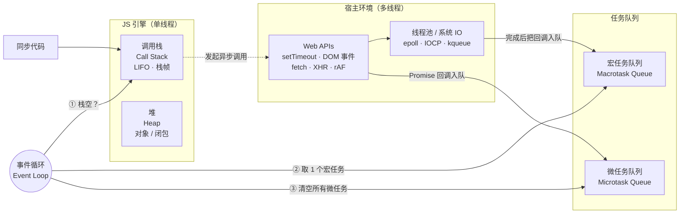
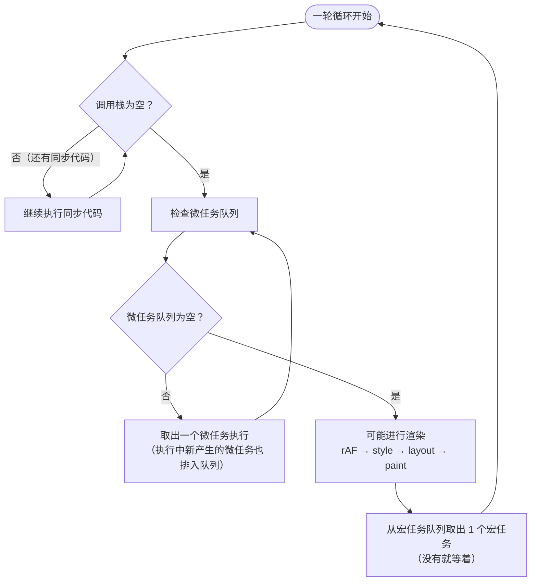
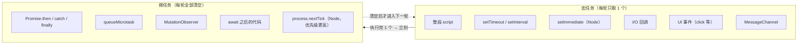
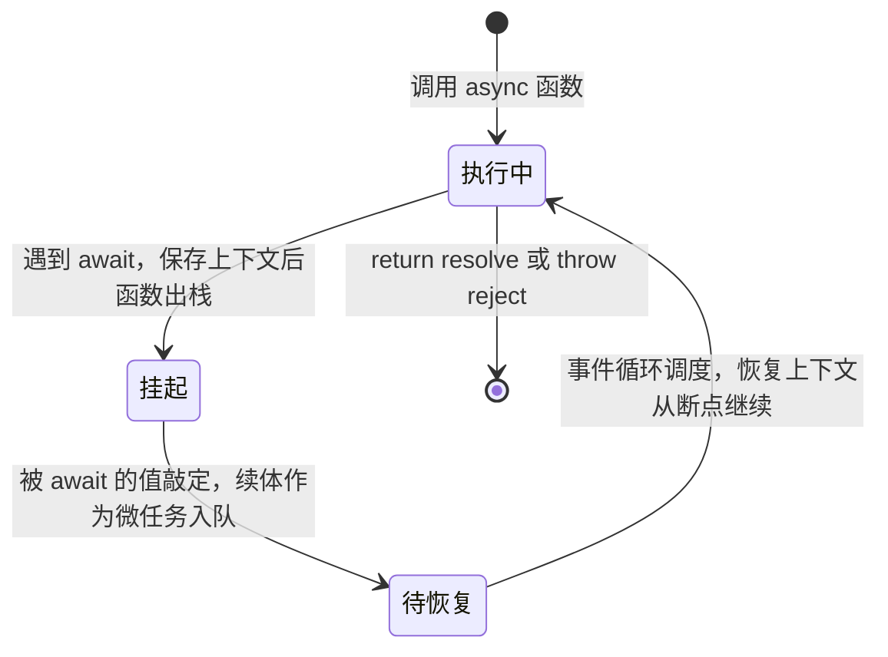
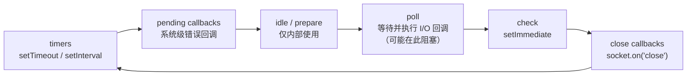

# 异步的底层机制：调用栈、任务队列与事件循环

> **一句话总结**：JavaScript 只有一条线程，异步之所以能成立，靠的是**三方分工**——JS 引擎只负责"执行"，宿主环境负责"等待"，**事件循环**负责把"等待完成的结果"重新捡回调用栈。理解了这套调度规则，所有"输出顺序为什么是这样"的问题都会自动有答案。

> [!abstract] 本文脉络
> 1. 前提：单线程意味着什么
> 2. 三大件：调用栈 / 堆 / 任务队列
> 3. 宿主的角色：Web APIs 与 libuv
> 4. 事件循环的一轮到底做了什么
> 5. 宏任务与微任务：两套队列的优先级
> 6. 完整走查：一道经典输出题
> 7. `await` 的底层：挂起与恢复
> 8. 渲染时机：为什么动画要用 `requestAnimationFrame`
> 9. Node.js 的 libuv 六阶段
> 10. 浏览器 vs Node 差异
> 11. 六个常见误区 + 面试题

---

## 一、前提：单线程意味着什么

JS 从设计之初就只有**一个调用栈、一条执行线程**。这意味着：

- 任何时刻**只能做一件事**，不存在真正的"并行执行 JS 代码"
- 一段同步代码没跑完，后面的代码一行都轮不到——包括用户点击、页面渲染

```js
// 这行会让页面彻底卡死 5 秒：按钮点不动、动画停住、滚动都没反应
const end = Date.now() + 5000;
while (Date.now() < end) {}
```

> [!important] 由此推出一个关键结论
> **异步不是"同时做两件事"，而是"先挂起、稍后回来接着做"。** 真正的"同时"发生在 JS 线程之外（宿主的多线程 / 系统 IO），JS 线程本身永远是排队串行的。

---

## 二、三大件：调用栈、堆、任务队列

整个异步机制由三块结构 + 一个调度器组成：



### 2.1 调用栈（Call Stack）

函数调用就压栈，返回就出栈，**后进先出**。

```js
function a() { b(); }
function b() { c(); }
function c() { throw new Error("看看栈"); }
a();
// Error: 看看栈
//     at c
//     at b
//     at a
```

栈有容量上限，递归过深就 `RangeError: Maximum call stack size exceeded`。

### 2.2 堆（Heap）

对象、闭包变量、Promise 实例都住在这里。它不参与调度，只负责"存放"。

### 2.3 任务队列（其实是两个）

> [!warning] 新手最大的误解
> **"任务队列"不是一条队列，而是两条：宏任务队列 + 微任务队列。** 两者的优先级完全不同，这是所有输出顺序题的命门。

---

## 三、宿主的角色：真正"等待"的是谁

`setTimeout(fn, 1000)` 里的 1 秒，**不是 JS 在数**：

| 环境 | 谁在计时 / 等 IO | 说明 |
|---|---|---|
| 浏览器 | 浏览器内核（Web APIs） | 定时器、DOM 事件、网络请求都由浏览器管，JS 线程不参与等待 |
| Node.js | libuv（C++ 库） | 内部有线程池（默认 4 线程）+ 各平台 IO 多路复用（epoll / kqueue / IOCP） |

流程是：**JS 线程把任务交出去 → 立刻继续往下执行 → 宿主完成后把回调塞进队列 → 事件循环负责捡回来执行。**

```mermaid
sequenceDiagram
    participant JS as JS 线程
    participant HOST as 宿主 Web APIs 或 libuv
    participant Q as 任务队列
    participant LOOP as 事件循环

    JS->>HOST: setTimeout(cb, 1000) 注册
    Note over JS: 立刻继续执行后面的同步代码
    HOST-->>HOST: 计时 1000ms（JS 线程不参与）
    HOST->>Q: 时间到，cb 入宏任务队列
    LOOP->>Q: 调用栈空了，来取任务
    Q-->>LOOP: 取出 cb
    LOOP->>JS: 压栈执行 cb
```

---

## 四、事件循环的一轮到底做了什么

这是全篇最重要的图，请记住这个顺序：



文字版规则（务必背下）：

1. **执行同步代码**，直到调用栈清空
2. **清空微任务队列**——注意是"清空"，不是"取一个"；执行中又产生的微任务会**当场继续执行**
3. （浏览器）**可能渲染**：`requestAnimationFrame` → 样式计算 → 布局 → 绘制
4. **取出一个宏任务执行**，然后回到第 2 步开始下一轮

> [!danger] 由此推出的两个后果
> - **微任务可以"无限续杯"**：如果微任务里不断产生新微任务，这一轮永远结束不了，页面直接卡死（渲染被饿死）
> - **宏任务是"一轮一个"**：所以 `setTimeout` 嵌套多少层都不会插队，只能一轮一轮排队

---

## 五、宏任务 vs 微任务



| 维度 | 宏任务 Macrotask | 微任务 Microtask |
|---|---|---|
| 每轮取几个 | **1 个** | **全部** |
| 典型来源 | 定时器、IO、UI 事件 | Promise 回调、`await` 后续 |
| 产生新任务 | 排到队尾，等下一轮 | **当场插队**，本轮执行完 |
| 优先级 | 低 | 高 |

---

## 六、完整走查：一道经典输出题

```js
console.log("1 script start");

setTimeout(() => console.log("2 setTimeout"), 0);

Promise.resolve().then(() => console.log("3 promise then"));

(async () => {
  console.log("4 async start");
  await null;                       // await 一个非 Promise 值
  console.log("5 after await");
})();

queueMicrotask(() => console.log("6 queueMicrotask"));

console.log("7 script end");
```

**执行时序表**（跟着走一遍，比背答案有用）：

| 步骤 | 动作 | 输出 | 队列状态 |
|:--:|---|---|---|
| 1 | 同步执行第一行 | `1 script start` | — |
| 2 | `setTimeout` 交给宿主，回调入**宏**队列 | — | 宏: [2] |
| 3 | `Promise.resolve().then` 回调入**微**队列 | — | 微: [3] |
| 4 | async 函数同步执行到 `await` | `4 async start` | 微: [3, 5]（await 后续入微） |
| 5 | `queueMicrotask` 入**微**队列 | — | 微: [3, 5, 6] |
| 6 | 最后一行同步执行 | `7 script end` | 栈空，开始清微任务 |
| 7 | 清空微任务队列（FIFO） | `3` → `5` → `6` | 微: [] |
| 8 | 取宏任务 | `2 setTimeout` | 宏: [] |

**最终输出**：

```
1 script start
4 async start
7 script end
3 promise then
5 after await
6 queueMicrotask
2 setTimeout
```

> [!tip] 三条万能判据
> 1. `new Promise(执行器)` **里面的代码是同步的**，只有 `.then` 回调是异步的
> 2. `await x` **会立刻把当前函数剩下的部分挂起**，剩下部分进微任务队列
> 3. **微任务全部先于任何一个宏任务**

---

## 七、`await` 的底层：挂起与恢复

`async/await` 在编译层面是**状态机 + 协程**——V8 会把一个 async 函数重写成可以"保存现场 / 恢复现场"的状态机。所以 `await` 能做到普通回调做不到的事：**保留局部变量、保留执行位置**。



关键细节：

```js
async function f() {
  console.log("A");     // 同步执行
  const v = await g();  // g() 先同步调用；然后 f 挂起出栈，续体入微任务队列
  console.log("B");     // 微任务：等微任务队列轮到它才执行
  return v;
}
```

> [!note] 三个必须分清的点
> - `await` **不阻塞线程**，只是让**当前函数**挂起出栈（所以别的代码照常跑）
> - `await` 之后的代码是**微任务**，不是宏任务 → 所以它总排在 `setTimeout` 前面
> - 即使 `await` 一个**非 Promise 值**（如 `await null`），也会让出一次微任务机会——这是"async 函数一定异步"的根源

---

## 八、渲染时机：为什么动画必须用 `requestAnimationFrame`

浏览器不会每执行一个任务就重绘一次，而是**攒一批改动，在一轮循环的空隙里统一渲染**。渲染就插在"微任务清空之后、下一个宏任务之前"：


由此解释三件事：

| 现象 | 原因 |
|---|---|
| `setTimeout(fn, 16)` 做动画会抖动 | 定时器**不保证在渲染前执行**，可能连续执行多次而中间没渲染，也可能错过渲染帧 |
| `requestAnimationFrame` 做动画顺滑 | 它**保证在渲染前一刻执行**，且帧率跟随屏幕（通常 60/120Hz） |
| 微任务死循环会冻结页面 | 微任务不刷完就不渲染，页面完全没机会重绘 |

> [!tip] 一条实用结论
> **改样式的批量操作放微任务（`Promise.then` / `queueMicrotask`），做逐帧动画用 `rAF`，别用 `setTimeout`。**

---

## 九、Node.js 的 libuv 六阶段

Node 的事件循环由 libuv 实现，比浏览器多了几个阶段，且**每个阶段都有一个回调队列**：



| 阶段 | 干什么 |
|---|---|
| **timers** | 执行到期的 `setTimeout` / `setInterval` 回调 |
| **pending callbacks** | 上一轮延迟的 TCP 错误等回调 |
| **idle / prepare** | libuv 内部使用 |
| **poll** | 核心阶段：取 I/O 事件执行；没有任务时会**在这里阻塞等待** |
| **check** | 执行 `setImmediate` 回调 |
| **close callbacks** | 执行 close 类回调 |

> [!important] Node 的两套"插队"机制
> - **`process.nextTick`**：优先级**最高**，在当前操作结束后、进入下一阶段前就执行（比 Promise 微任务还早）
> - **微任务（Promise）**：在每个阶段切换之间清空
>
> 顺序记忆：`nextTick` 队列 → 微任务队列 → 下一阶段。

```js
setTimeout(() => console.log("timeout"), 0);
setImmediate(() => console.log("immediate"));
// 在顶层执行时顺序不确定！取决于进入 timers 阶段时 1ms 是否已过
// 但如果在 I/O 回调里，setImmediate 永远先于 setTimeout
```

---

## 十、浏览器 vs Node：差异对照

| 维度 | 浏览器 | Node.js |
|---|---|---|
| 调度实现 | 浏览器内核（HTML 规范） | libuv（C++） |
| 循环结构 | 单轮：1 宏任务 + 清微任务 + 渲染 | 六阶段，每阶段切换时清微任务 |
| 最高优先级 | 微任务（无 nextTick） | `process.nextTick` > 微任务 |
| 独有 API | `requestAnimationFrame`、`MutationObserver` | `setImmediate`、`process.nextTick` |
| IO 模型 | 浏览器内部（不可见） | epoll / kqueue / IOCP + 线程池 |
| 渲染 | 有（渲染管线） | 无 |

---

## 十一、六个常见误区

> [!warning] 误区清单
> 1. **`setTimeout(fn, 0)` 就是立即执行** → 错。最小延迟受规范限制（嵌套 5 层后钳制为 4ms），且必须等前面所有宏任务、微任务跑完。
> 2. **`await` 会阻塞线程** → 错。它只是让当前函数挂起出栈，线程继续跑别的。
> 3. **`new Promise` 里的代码是异步的** → 错。执行器**同步立即执行**，只有 `.then` 回调异步。
> 4. **Promise 比 setTimeout 快** → 不是"快"，是**队列优先级不同**（微任务 vs 宏任务）。
> 5. **事件循环保证准时** → 它只保证"不早于"，延迟取决于前面任务的总耗时。
> 6. **`async` 函数一定返回 Promise，所以可以随便当同步用** → 它返回的 Promise 需要一个调度周期才能拿到值，别在同一个 tick 里依赖结果。

---

## 十二、面试题（先自己想，再展开）

**Q1**：下面输出顺序是？

```js
setTimeout(() => console.log("A"), 0);
Promise.resolve().then(() => {
  console.log("B");
  Promise.resolve().then(() => console.log("C"));
});
console.log("D");
```

<details>
<summary>答案</summary>

```
D → B → C → A
```

微任务队列在清空时会**继续执行期间新产生的微任务**（B 里产生的 C），全部清完才轮到宏任务 A。

</details>

**Q2**：为什么 `await` 后面的代码比 `setTimeout(0)` 先执行？

<details>
<summary>答案</summary>

因为 `await` 的续体被放进**微任务队列**，而 `setTimeout` 的回调在**宏任务队列**。事件循环每轮先清空全部微任务，再取一个宏任务。队列优先级决定先后，与"时间"无关。

</details>

**Q3**：用事件循环解释"页面为什么会卡死"？

<details>
<summary>答案</summary>

渲染发生在"微任务清空之后、下一个宏任务之前"。如果同步代码长时间占用调用栈，或微任务不断自我繁殖，事件循环永远走不到渲染那一步，页面就没有机会重绘 → 表现为完全冻结。CPU 密集计算的正确解法是 Worker（换线程），而不是包一层 Promise。

</details>

---

## 小结

> [!abstract] 记住这五句
> 1. **JS 单线程**，异步的本质是"挂起 + 稍后恢复"，不是"同时执行"。
> 2. **等待发生在宿主**（Web APIs / libuv），JS 只负责执行和调度。
> 3. **一轮循环 = 执行同步代码 → 清空所有微任务 →（可能渲染）→ 取一个宏任务**。
> 4. **微任务优先于宏任务**；`await` 的续体、`Promise.then` 都是微任务；Node 里 `process.nextTick` 比微任务更早。
> 5. **渲染夹在微任务与下一个宏任务之间**，所以动画用 `rAF`，批量 DOM 操作用微任务，CPU 密集用 Worker。

**关联笔记**：[[15-异步JavaScript与事件循环]] · [[02-JS如何执行与调用栈]] · [[16-JS引擎与V8架构]] · [[17-setTimeout的可信度问题]] · [[21-Promise]] · [[23-async与await]] · [[解决异步的几种方法]]
