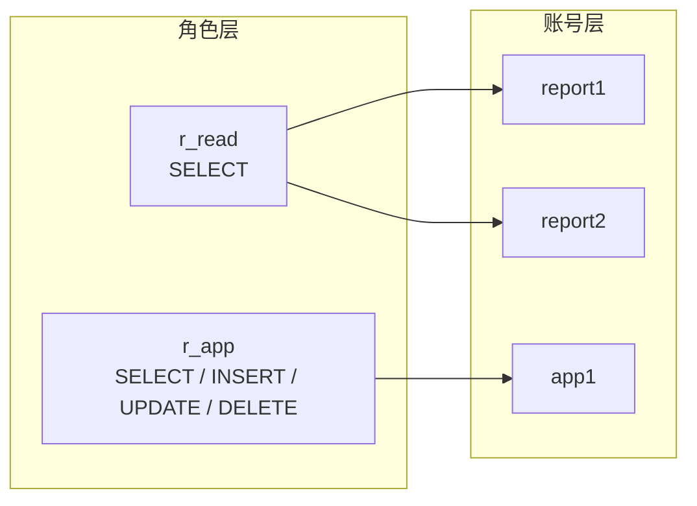

# ROLE —— 角色

> [!abstract] 一句话
> 角色（Role）是"**一组权限的命名集合**"。
> 先把权限打包成角色，再把角色发给账号；改权限只改角色一处，不用逐个账号 `GRANT`。

> [!info] 本篇在 DCL 中的位置
> [[GRANT]] 发单把钥匙 → [[REVOKE]] 收单把钥匙 → **ROLE 先配一串钥匙，再整串发放**。
> 角色是 MySQL **8.0** 才有的能力，5.7 及以前没有。
> 四类 SQL 的分工见 [[四大SQL分类讲解]]。

---

## 一、为什么需要角色

没有角色时，权限是"账号 × 权限"的笛卡尔积：

```text
report1  ← SELECT ON school.*
report2  ← SELECT ON school.*
report3  ← SELECT ON school.*
app1     ← SELECT, INSERT, UPDATE, DELETE ON school.*
app2     ← SELECT, INSERT, UPDATE, DELETE ON school.*
```

问题很直接：

| 问题 | 后果 |
| --- | --- |
| 同一套权限重复写 N 遍 | 容易漏授、授错 |
| 权限要调整 | 每个账号都要改一遍 |
| 新人入职 | 靠"复制上一个人的 `SHOW GRANTS`" |
| 离职 / 调岗 | 不知道哪些权限该收 |

有角色之后，变成"**账号 → 角色 → 权限**"：



> [!success] 核心收益
> - 权限定义只有**一份**，改角色即改所有持有者；
> - 账号只关心"我是什么角色"，不关心"我有哪些权限"；
> - 离职收回一个角色即可，不用逐条 `REVOKE`；
> - 权限模型和岗位职责一一对应，审计更清晰。

---

## 二、角色到底是什么

> [!note] 角色 ≈ "锁定的、不能登录的账号"
> 在 MySQL 内部，角色保存在 `mysql.user` 表里，表现为：
> - `account_locked = 'Y'`：不能登录；
> - 没有可用密码；
> - 可以像账号一样持有权限；
> - 通过 `mysql.role_edges` 记录"谁被授予了哪个角色"。
>
> 所以你会在 `mysql.user` 里看到角色名，这是正常的，不是脏数据。

| 维度 | 用户（User） | 角色（Role） |
| --- | --- | --- |
| 能否登录 | ✅ | ❌（被锁定） |
| 能否持有权限 | ✅ | ✅ |
| 能否被授予给账号 | ✅（账号可持有角色） | ✅（角色可发给账号） |
| 能否被授予给角色 | ❌ | ❌（MySQL 不支持角色嵌套） |
| 需要密码 | 通常需要 | 不需要 |
| 创建语句 | `CREATE USER` | `CREATE ROLE` |
| 删除语句 | `DROP USER` | `DROP ROLE` |
| 用途 | 登录主体 | 权限包 |

> [!warning] MySQL 8.0 不支持角色嵌套
> 不能写 `GRANT 'r_read' TO 'r_app';` 把角色授给角色。
> 需要"组合权限"时，把多个角色**同时授予用户**：
> ```sql
> GRANT 'r_read', 'r_app' TO 'alice'@'%';
> ```
> 这一点和 PostgreSQL 不同，迁移或跨库设计时要注意。

> [!tip] 角色名建议加前缀
> 用 `r_read`、`r_app`、`r_admin` 这种命名，一眼能和普通账号区分开。
> 角色默认 host 是 `'%'`，一般不需要显式写 host。

---

## 三、语法总览

```sql
-- 创建 / 删除
CREATE ROLE [IF NOT EXISTS] '角色名' [, ...];
DROP ROLE   [IF EXISTS] '角色名' [, ...];

-- 给角色配权限（和给账号授权完全一样）
GRANT 权限列表 ON 权限范围 TO '角色名';

-- 把角色授予账号 / 收回
GRANT '角色名' [, ...] TO '用户名'@'主机' [, ...] [WITH ADMIN OPTION];
REVOKE '角色名' [, ...] FROM '用户名'@'主机' [, ...];
REVOKE ADMIN OPTION FOR '角色名' FROM '用户名'@'主机';

-- 默认角色（登录后自动激活）
SET DEFAULT ROLE {NONE | ALL | '角色名' [, ...]} TO '用户名'@'主机';

-- 当前会话激活角色
SET ROLE {NONE | ALL | DEFAULT | '角色名' [, ...]};

-- 查看
SHOW GRANTS FOR '角色名';
SHOW GRANTS FOR '用户名'@'主机';
SHOW GRANTS FOR '用户名'@'主机' USING '角色名';
CURRENT_ROLE();
```

| 语句 | 作用 | 是否立刻影响当前会话 |
| --- | --- | --- |
| `CREATE ROLE` | 建角色 | — |
| `GRANT 权限 TO 角色` | 给角色配权限 | 对已激活该角色的会话生效 |
| `GRANT 角色 TO 账号` | 账号获得角色 | ❌ 未激活前不生效 |
| `SET DEFAULT ROLE` | 设登录时自动激活的角色 | ❌ 下次登录生效 |
| `SET ROLE` | 当前会话激活 / 停用角色 | ✅ 立即生效 |
| `REVOKE 角色 FROM 账号` | 解除绑定 | 新会话生效，旧会话建议重连 |
| `DROP ROLE` | 删除角色及其绑定 | 持有者立即失去该角色 |

> [!important] `GRANT 角色` 之后，权限不会自动生效
> 这是角色最大的坑：
> **授予角色 ≠ 激活角色。**
> 账号必须通过"默认角色"或 `SET ROLE` 把角色**激活**，角色里的权限才算数。
> 详见本文第五节。

---

## 四、完整示例：只读 / 业务 / 管理三角色

### 4.1 建角色并配权限

```sql
-- 1. 建三个角色
CREATE ROLE 'r_read', 'r_app', 'r_admin';

-- 2. 只读角色：整库查询
GRANT SELECT ON school.* TO 'r_read';

-- 3. 业务角色：增删改查，但不给 DDL
GRANT SELECT, INSERT, UPDATE, DELETE ON school.* TO 'r_app';

-- 4. 管理角色：库内全部权限（仍然不给全局权限）
GRANT ALL PRIVILEGES ON school.* TO 'r_admin';
```

> [!tip] 角色里不要塞 `GRANT OPTION`
> `r_admin` 只应该"能管理数据"，不应该"能给别人授权"。
> 真需要分级授权，单独设计一个 `r_grantor`，并配合 `WITH ADMIN OPTION` 严格控制。

### 4.2 建账号并发放角色

```sql
-- 1. 建账号
CREATE USER 'report'@'%' IDENTIFIED BY 'Report_2026!';
CREATE USER 'app'@'%'    IDENTIFIED BY 'App_2026!';
CREATE USER 'ops'@'%'    IDENTIFIED BY 'Ops_2026!';

-- 2. 发角色
GRANT 'r_read'  TO 'report'@'%';
GRANT 'r_app'   TO 'app'@'%';
GRANT 'r_admin' TO 'ops'@'%';

-- 3. 设为默认角色（登录后自动激活）
SET DEFAULT ROLE 'r_read'  TO 'report'@'%';
SET DEFAULT ROLE 'r_app'   TO 'app'@'%';
SET DEFAULT ROLE 'r_admin' TO 'ops'@'%';
```

### 4.3 验证

```sql
-- 角色自己有哪些权限
SHOW GRANTS FOR 'r_read';

-- 账号被授予了哪些角色
SHOW GRANTS FOR 'report'@'%';
-- GRANT USAGE ON *.* TO `report`@`%`
-- GRANT `r_read`@`%` TO `report`@`%`

-- 账号"激活 r_read 后"实际有哪些权限
SHOW GRANTS FOR 'report'@'%' USING 'r_read';
```

> [!note] `USAGE` 再次出现
> `GRANT USAGE ON *.*` 表示账号本身没有直接权限，权限都在角色里。
> 不要误判成"没授权成功"。

### 4.4 新增一个只读用户有多简单

```sql
CREATE USER 'report2'@'%' IDENTIFIED BY 'Report2_2026!';
GRANT 'r_read' TO 'report2'@'%';
SET DEFAULT ROLE 'r_read' TO 'report2'@'%';
```

不需要再写一遍 `SELECT ON school.*`。

---

## 五、默认角色 vs 激活角色（重点）

角色有两层状态：

| 状态 | 含义 | 由什么控制 |
| --- | --- | --- |
| **已授予（granted）** | 账号"拥有"这个角色 | `GRANT 'r' TO user` |
| **已激活（active）** | 当前会话"正在使用"这个角色 | `SET DEFAULT ROLE` / `SET ROLE` |

```text
已授予  ──激活──▶  已激活  ──▶  权限生效
   ▲                  │
   └──── 未激活 ──────┘   ← 有角色，但没权限
```

### 5.1 `SET DEFAULT ROLE`：登录时自动激活

```sql
SET DEFAULT ROLE 'r_read' TO 'report'@'%';   -- 指定角色
SET DEFAULT ROLE ALL      TO 'report'@'%';   -- 所有已授予角色都设为默认
SET DEFAULT ROLE NONE     TO 'report'@'%';   -- 清空默认角色
```

> [!warning] 默认角色只对**之后的登录**生效
> 对已经连着的会话，改 `SET DEFAULT ROLE` 不会立刻改变当前激活状态。
> 当前会话要用 `SET ROLE` 手动切换。

### 5.2 `SET ROLE`：当前会话手动激活

```sql
SET ROLE 'r_read';        -- 只激活指定角色
SET ROLE ALL;             -- 激活所有已授予角色
SET ROLE NONE;            -- 停用所有角色
SET ROLE DEFAULT;         -- 回到默认角色
```

> [!tip] 临时提权的正确姿势
> 需要临时用一下管理角色：
> ```sql
> SET ROLE 'r_admin';
> -- 执行管理操作
> SET ROLE DEFAULT;   -- 立刻退回默认角色
> ```
> 比"改账号权限再改回来"安全得多。

### 5.3 查看当前激活了什么

```sql
SELECT CURRENT_ROLE();
-- r_read@%
-- 或 NONE
```

### 5.4 两个全局开关

| 变量 | 作用 | 默认 |
| --- | --- | --- |
| `activate_all_roles_on_login` | 登录时自动激活**所有**已授予角色 | `OFF` |
| `mandatory_roles` | 强制授予所有账号的角色，不能用 `REVOKE` 去掉 | 空 |

```sql
-- 让所有账号登录时激活全部角色（谨慎）
SET PERSIST activate_all_roles_on_login = ON;

-- 全站强制基础角色（谨慎）
SET PERSIST mandatory_roles = 'r_read';
```

> [!danger] 这两个开关都会放大权限
> - `activate_all_roles_on_login = ON` 意味着"授了就生效"，`SET DEFAULT ROLE` 失去意义，最小权限更难保证。
> - `mandatory_roles` 会对**所有账号**（包括未来新建的）生效，且不能单独收回。
>
> 生产环境除非有明确的全站策略，否则保持默认。

---

## 六、角色的日常维护

### 6.1 角色加权限：所有持有者一起升级

```sql
GRANT INSERT ON school.* TO 'r_read';
-- 所有持有 r_read 且已激活的账号，下一条语句就有 INSERT
```

> [!success] 这是角色最大的价值
> 以前要给 20 个只读账号加权限，得执行 20 条 `GRANT`；
> 现在只改角色 1 次。

### 6.2 角色减权限

```sql
REVOKE DELETE ON school.* FROM 'r_app';
```

注意：`REVOKE ... FROM '角色名'` 和 `REVOKE ... FROM '账号'` 语法一样，只是对象不同。
层级规则同样适用，详见 [[REVOKE]]。

### 6.3 收回账号的角色

```sql
REVOKE 'r_admin' FROM 'ops'@'%';
```

> [!note] 收回角色 ≠ 删除角色
> 角色和它的权限定义还在，其他持有者不受影响。
> 账号只是不再"拥有"这个角色。
> 如果这个角色是账号的默认角色，收回后默认角色也一并失效。

### 6.4 删除角色

```sql
DROP ROLE 'r_read';
```

> [!warning] `DROP ROLE` 会连带解除所有绑定
> 所有持有该角色的账号立即失去它，`mysql.role_edges` 里的记录一并清理。
> 删除前先确认影响面：
> ```sql
> SELECT * FROM mysql.role_edges WHERE FROM_USER = 'r_read';
> ```
> 或者逐个 `SHOW GRANTS FOR '账号'` 检查。

### 6.5 清空角色的权限但保留角色

```sql
REVOKE ALL PRIVILEGES, GRANT OPTION FROM 'r_read';
```

> [!tip] 停用 vs 删除
> - 想暂时让角色"没权限"：清空权限，保留绑定，之后再加回来；
> - 想彻底不用：`DROP ROLE`。
>
> 注意 `REVOKE ALL PRIVILEGES` **不会**收回角色里的动态权限，动态权限要按名收回。

---

## 七、角色与权限的边界

### 7.1 角色可以持有哪些权限

和账号一样，角色可以持有：

- 全局权限：`GRANT SELECT ON *.* TO 'r_monitor';`
- 库级权限：`GRANT SELECT ON school.* TO 'r_read';`
- 表级权限：`GRANT SELECT ON school.student TO 'r_read';`
- 列级权限：`GRANT SELECT (name, score) ON school.student TO 'r_read';`
- 程序权限：`GRANT EXECUTE ON PROCEDURE school.p_stats TO 'r_read';`
- 动态权限：`GRANT BACKUP_ADMIN ON *.* TO 'r_backup';`

### 7.2 角色不能做的事

| 限制 | 说明 |
| --- | --- |
| 不能登录 | 角色是被锁定的账号 |
| 不能嵌套 | 角色不能授予角色 |
| 不能设密码 | 没有认证信息 |
| 不能替代账号 | 应用连接仍然要具体账号 + 密码 |

> [!note] 角色的 host 有意义吗
> 有。`CREATE ROLE 'r_read'` 等价于 `CREATE ROLE 'r_read'@'%'`。
> 授予时写 `'r_read'` 默认就是 `'r_read'@'%'`。
> 一般统一用默认 host，避免出现 `'r_read'@'%'` 和 `'r_read'@'localhost'` 两个"同名不同角色"的混乱。

---

## 八、角色 vs 传统逐账号授权

| 对比项 | 逐账号 `GRANT` | 角色 |
| --- | --- | --- |
| 权限定义份数 | 每个账号一份 | 每个角色一份 |
| 新增账号 | 重写全部权限 | 发一个角色 |
| 调整权限 | 改 N 个账号 | 改 1 个角色 |
| 离职收回 | 逐条 `REVOKE` | 收回角色 |
| 权限审计 | 看每个账号的 `SHOW GRANTS` | 看角色定义 + 角色绑定 |
| 误授风险 | 高（复制粘贴） | 低（统一入口） |
| 学习成本 | 低 | 需要理解"授予 vs 激活" |
| 版本要求 | 所有版本 | MySQL 8.0+ |

> [!tip] 什么时候仍然需要直接授权
> - 一次性的、只属于某个账号的特殊权限；
> - 临时排障；
> - 角色模型还没建好时的过渡。
>
> 长期权限一律走角色，直接授权只做例外。

---

## 九、最佳实践

> [!success] 角色设计八条
> 1. **按职责建角色，不按人建角色**：`r_read`、`r_app`、`r_dba`，而不是 `r_alice`。
> 2. **一个角色一个职责**：不要把只读和写入混在同一个角色里。
> 3. **角色里不放 DDL 权限**，除非它明确是 DBA 角色。
> 4. **角色里不放 `GRANT OPTION` / `ADMIN OPTION`**，除非确有分级授权需求。
> 5. **显式设置默认角色**：`SET DEFAULT ROLE`，否则用户登录后"有角色却没权限"。
> 6. **命名统一前缀**：`r_` 开头，和账号区分。
> 7. **删除角色前先查绑定**：`mysql.role_edges` 或 `SHOW GRANTS`。
> 8. **定期审计**：角色定义是否膨胀、绑定是否与岗位一致。

```sql
-- 推荐的建角色模板
CREATE ROLE 'r_read';
GRANT SELECT ON school.* TO 'r_read';

CREATE USER 'report'@'%' IDENTIFIED BY '强密码';
GRANT 'r_read' TO 'report'@'%';
SET DEFAULT ROLE 'r_read' TO 'report'@'%';

-- 验证
SHOW GRANTS FOR 'report'@'%' USING 'r_read';
```

> [!warning] 别忘了"激活"这一步
> 生产事故里最常见的角色问题不是"角色建错了"，而是：
> **角色授了，但没设默认角色，用户登录后以为自己有权限，实际执行时报 `Access denied`。**
>
> 上线检查清单里加一条：`SHOW GRANTS FOR user USING role` 能查到预期权限。

---

## 十、常见报错与坑

> [!failure] 坑一：授了角色，但用户还是没权限
> 原因：角色未激活。
> 解决：`SET DEFAULT ROLE 'r' TO user;`（下次登录生效）或当前会话 `SET ROLE 'r';`。
> 验证：`SELECT CURRENT_ROLE();`

> [!failure] 坑二：`SET DEFAULT ROLE` 报角色未授予
> 默认角色必须建立在"已授予"的基础上。先 `GRANT 'r' TO user`，再 `SET DEFAULT ROLE`。

> [!failure] 坑三：`SET ROLE` 报角色未授予
> 同理，账号没有这个角色不能激活。
> 也可能是 host 不匹配：`'u'@'%'` 和 `'u'@'localhost'` 是两个账号。

> [!failure] 坑四：以为 `REVOKE ALL PRIVILEGES` 会收回角色
> 不会。角色要用 `REVOKE 'r' FROM user` 单独收回。

> [!failure] 坑五：以为删账号会删角色
> `DROP USER` 删的是账号；角色是独立对象，仍然存在。
> 反过来，`DROP ROLE` 会解除所有账号对它的绑定。

> [!failure] 坑六：尝试角色嵌套
> `GRANT 'r1' TO 'r2'` 不被支持。
> 需要组合权限时，把多个角色一起授予用户。

> [!failure] 坑七：5.7 环境照抄 8.0 语法
> MySQL 5.7 没有角色，`CREATE ROLE` 直接报语法错误。
> 跨版本脚本要做兼容判断。

> [!failure] 坑八：`activate_all_roles_on_login` 掩盖了设计问题
> 打开后"授了就生效"，看似方便，实际让最小权限和默认角色设计失效。
> 排查权限问题时，先确认这个变量是否为 `ON`。

> [!failure] 坑九：角色名带 host，授权时写错
> `GRANT 'r_read'@'%' TO ...` 和 `GRANT 'r_read' TO ...` 在默认 host 下等价；
> 但如果角色是用非默认 host 建的，省略 host 就会报"角色不存在"。

> [!failure] 坑十：删角色前没评估影响
> `DROP ROLE` 不影响数据，但会让所有持有者瞬间失去权限，可能引发业务故障。
> 先在低峰期执行，或先 `REVOKE` 绑定观察。

---

## 十一、常见面试问答

> [!question] Q1：什么是角色？
> 角色是一组权限的命名集合，可以像账号一样持有权限，也可以授予账号。
> 目的是把"账号 → 权限"的多对多关系，简化成"账号 → 角色 → 权限"。

> [!question] Q2：角色和用户有什么区别？
> 用户能登录，角色不能（角色是被锁定的账号）；
> 两者都能持有权限，但角色只能授予账号，不能授予角色（MySQL 不支持嵌套）。

> [!question] Q3：为什么 `GRANT 'r_read' TO user` 之后用户还是没权限？
> 因为只"授予"没有"激活"。
> 需要 `SET DEFAULT ROLE 'r_read' TO user`（下次登录生效），或当前会话 `SET ROLE 'r_read'`。

> [!question] Q4：`SET DEFAULT ROLE` 和 `SET ROLE` 有什么区别？
> `SET DEFAULT ROLE` 改的是"账号登录时默认激活哪些角色"，对下一次登录生效；
> `SET ROLE` 改的是"当前会话激活哪些角色"，立即生效。
> `SET ROLE DEFAULT` 是回到默认角色。

> [!question] Q5：角色能嵌套吗？
> MySQL 8.0 不支持。需要组合权限时，把多个角色同时授予同一个用户。
> PostgreSQL 支持角色嵌套，迁移时要注意差异。

> [!question] Q6：怎么查看当前会话激活了哪些角色？
> `SELECT CURRENT_ROLE();`
> 返回 `NONE` 表示没有激活任何角色；否则返回角色名（可能多个）。

> [!question] Q7：怎么查看角色本身有哪些权限？
> `SHOW GRANTS FOR '角色名';`
> 想看"某用户激活某角色后的有效权限"：`SHOW GRANTS FOR 'u'@'h' USING '角色名';`

> [!question] Q8：删除角色会怎样？
> `DROP ROLE` 删除角色定义和所有绑定，持有者立即失去该角色及其权限。
> 角色里的权限定义一并消失，但账号本身不受影响。

> [!question] Q9：角色和"直接给账号授权"怎么选？
> 长期、可复用的权限走角色；一次性、排障用的特殊权限可以直接授权。
> 角色更适合有明确岗位划分、账号数量较多的场景。

> [!question] Q10：`mandatory_roles` 是什么？
> 一个全局系统变量，列在其中的角色会授予所有账号，且不能用 `REVOKE` 去掉。
> 影响面覆盖全实例（包括未来新建的账号），生产环境慎用。

> [!question] Q11：角色权限变了，什么时候生效？
> 权限检查是实时的：角色加 / 减权限后，已激活该角色的会话在下一条语句就会按新权限执行。
> 但"账号是否持有角色"的变更，建议让相关会话重连，或用 `SET ROLE` 明确当前状态。

> [!question] Q12：为什么推荐用角色而不是复制 `GRANT`？
> 权限定义只有一份，变更只改一处；账号管理变成"发角色 / 收角色"；
> 审计时能直接看到岗位对应的权限包，减少漏授和误授。

---

> [!quote] 一句话记忆
> **角色是"权限包"：先打包，再发人；**
> **授予不等于激活，`SET DEFAULT ROLE` / `SET ROLE` 才让权限真正生效。**

---

## 相关笔记

- [[GRANT]] —— 给角色配置权限、把角色授予账号
- [[REVOKE]] —— 收回角色、收回角色里的权限
- [[四大SQL分类讲解]] —— DCL 在四类 SQL 中的位置
- [[Create Table]] · [[Select]] · [[Insert]] · [[Update]] · [[Delete]] —— 角色里最常打包的权限
- [[存储过程]] · [[存储函数]] —— 角色可以持有 `EXECUTE` 权限
- [[BEGIN]] · [[COMMIT]] · [[ROLLBACK]] —— 角色管理与事务的隐式提交
