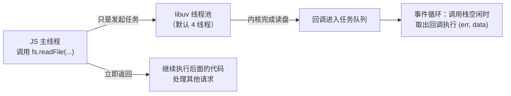

# readFile 与 readFileSync 的区别

> [!info] 本篇覆盖
> `fs.readFile` 与 `fs.readFileSync` 的完整对比：API 形态、**阻塞与否的本质**、错误处理差异、Buffer 与编码、libuv 线程池底层、现代第三种写法 `fs.promises`、五个常见坑。
> 一句话目标：**知道什么时候敢用同步、什么时候必须异步，以及为什么。**

---

## 一、一句话结论

| | `fs.readFileSync` | `fs.readFile` |
|---|---|---|
| 本质 | **阻塞调用**：JS 线程原地等 IO 完成 | **非阻塞调用**：IO 交给 libuv 线程池，完成后回调 |
| 读法 | 读文件期间**整个进程停摆** | 读文件期间事件循环照常跑别的 |

> [!important] 核心认知
> 区别**不是"快与慢"**——总耗时几乎一样。真正的区别是：**等待的那段时间，JS 线程是"卡死"还是"去干别的活"**。单线程的 Node 里，这两者是天壤之别。

---

## 二、两种 API 的基本用法

### 2.1 同步版：返回值就是结果

```js
const fs = require("fs");

// 不传 encoding → 返回 Buffer
const buf = fs.readFileSync("./hello.txt");
console.log(buf); // <Buffer 48 65 6c 6c 6f ...>

// 传 encoding → 返回 string
const text = fs.readFileSync("./hello.txt", "utf8");
console.log(text); // Hello

// 读取失败 → 直接 throw（可以 try/catch）
```

### 2.2 异步版：结果通过回调拿

```js
const fs = require("fs");

fs.readFile("./hello.txt", "utf8", (err, data) => {
  if (err) {
    console.error("读取失败", err);
    return;
  }
  console.log(data); // Hello
});

// 这一行会【先】执行——readFile 只是"发起"，结果要等回调
console.log("发起读取后立即打印");
```

> [!note] 参数完全一致，差别只在"怎么交结果"
> 两者签名只差最后一样东西：同步版把结果**作为返回值**给你，异步版把结果**作为回调参数**给你。`err-first`（错误优先）是 Node 异步回调的铁律：第一个参数永远是错误对象，成功时为 `null`。

---

## 三、全维度对比表

| 维度 | `readFileSync` | `readFile` |
|---|---|---|
| 调用形态 | 同步阻塞 | 异步非阻塞 |
| 结果获取 | 返回值 | 回调参数 `(err, data)` |
| 读取期间主线程 | **被占用，其他任务全部等待** | 空闲，可处理其他请求/事件 |
| 错误处理 | `try / catch` | 回调第一参数 `err`（**try/catch 无效**） |
| 事件循环 | 不参与（直接卡住） | IO 在 libuv 线程池执行，回调进入任务队列 |
| 并发读多个文件 | 串行，耗时相加 | 并行（受线程池上限约束，默认 4） |
| 异常安全性 | 高（流程直观） | 低（忘记 return / 漏判 err 是经典事故） |
| 典型场景 | 启动时加载配置、CLI 脚本、构建工具 | HTTP 请求处理、服务运行期的一切读文件 |
| 代码可读性 | 像"正常代码"，好读 | 回调嵌套、错误分支分散 |

---

## 四、readFileSync 的代价：把整个服务器卡住

单线程 Node 的最大禁忌，就是**在处理请求的路径上做同步 IO**。看这个反面教材：

```js
const http = require("http");
const fs = require("fs");

http
  .createServer((req, res) => {
    // ❌ 灾难：每个请求都会把整个进程卡住 100ms
    const data = fs.readFileSync("./big.json", "utf8");
    res.end(data);
  })
  .listen(3000);
```

假设读这个文件需要 100ms，会发生什么：


- 100 个并发请求 → 最后一个要等 **10 秒**才被响应
- 期间**所有**其他事件（新连接、socket 数据、定时器）全部冻结
- 如果读的是 1GB 文件，服务器直接"假死"

> [!danger] 一条铁律
> **请求处理器里永远不要出现任何 `*Sync` API。** Node 官方文档的原话是：同步 API 会阻塞事件循环，直到操作完成——这在服务运行期几乎总是错误。

### 反过来，为什么启动时用同步反而更好

```js
// ✅ 服务器启动阶段：读一次配置，阻塞一下完全无妨
const config = JSON.parse(fs.readFileSync("./config.json", "utf8"));
const secret = fs.readFileSync("./private.key");

http.createServer((req, res) => {
  // 请求处理里用现成的变量，不再碰磁盘
  res.end(config.appName);
}).listen(3000);
```

启动时进程还没有服务要照顾，**阻塞的只是"开机"**；而且把配置提前加载成模块级变量，请求期零磁盘 IO——这比每次请求去异步读文件更快也更简单。同步代码在这里反而**兼具性能与可读性**。

> [!tip] 判断标准一句话
> **"这段代码执行时，进程是否已经开始服务？"** 还没有 → 放心同步；已经在服务 → 必须异步。

---

## 五、readFile 的底层：libuv 线程池 + 事件循环

`readFile` 为什么不阻塞？因为**磁盘 IO 根本不在 JS 线程上干**：



逐步拆解：

1. **发起阶段**（主线程）：验证参数、打开文件描述符的准备工作，几乎瞬间完成，然后立即返回 `undefined`
2. **等待阶段**（线程池）：真正的读盘由 libuv 线程池的工作线程执行（Linux 上最终走 `epoll`/`aio`，Windows 走 `IOCP`）
3. **交付阶段**（主线程）：读完后回调被推入任务队列，等**事件循环**发现调用栈空闲，把它取出来执行——这就是 [[09-Node架构与事件循环]] 里讲的调度规则

所以"异步"的完整含义是：**发起、等待、交付三个阶段，只有第三步回调执行会占用主线程，而且那一刻 IO 已经完成，瞬间就结束。**

### 并发读：异步版的隐藏优势

```js
const t0 = performance.now();

// 三个文件"同时"读：总耗时 ≈ 最慢的那个
fs.readFile("a.txt", "utf8", () => {});
fs.readFile("b.txt", "utf8", () => {});
fs.readFile("c.txt", "utf8", () => {});

// 同步版只能串行：总耗时 = 三者之和
```

线程池默认 4 个线程，超过 4 个并发 IO 会排队——可以用环境变量 `UV_THREADPOOL_SIZE` 调整。

---

## 六、返回值细节：Buffer 与 encoding

这是两个 API 共用的知识点，但最容易出错：

```js
// ❌ 忘了 encoding，拿到的是 Buffer
fs.readFile("./data.json", (err, data) => {
  console.log(data.name);        // undefined！Buffer 没有 .name
  JSON.parse(data);              // TypeError：参数必须是字符串
});

// ✅ 方式一：传 encoding
fs.readFile("./data.json", "utf8", (err, data) => {
  JSON.parse(data);              // OK
});

// ✅ 方式二：手动 toString
fs.readFile("./data.json", (err, buf) => {
  JSON.parse(buf.toString("utf8")); // OK
});
```

| 传参方式 | 返回类型 | 适用 |
|---|---|---|
| 不传 `encoding` | `Buffer`（原始字节） | 图片、二进制、需要再加工 |
| `"utf8"` / `"base64"` 等 | `string` | 文本、JSON |

> [!warning] Buffer 不是字符串
> 直接 `console.log(buffer)` 打出来是十六进制字节，拼接、`JSON.parse`、模板字符串都会出错。记住两个出路：**传 `encoding` 参数**，或 **`buf.toString()`**。

---

## 七、错误处理：两者是完全不同的两套体系

### 7.1 同步版：try/catch 有效

```js
try {
  const data = fs.readFileSync("./不存在.txt", "utf8");
} catch (err) {
  console.error(err.code); // ENOENT（文件不存在）
}
```

### 7.2 异步版：try/catch **抓不到**

```js
// ❌ 经典错误：以为 try/catch 能兜住异步错误
try {
  fs.readFile("./不存在.txt", "utf8", (err, data) => {
    if (!err) doSomething(data);
  });
} catch (err) {
  // 永远不会执行！
}

// ✅ 正确：错误只出现在回调的第一参数
fs.readFile("./不存在.txt", "utf8", (err, data) => {
  if (err) {
    console.error(err.code); // ENOENT
    return;                  // 必须 return，否则继续往下会用到 undefined
  }
  doSomething(data);
});
```

> [!why] 为什么 try/catch 失效？
> `try` 只能捕获**调用栈上**抛出的异常。调用 `readFile` 时只发生了"发起"（这一步正常返回），真正的错误发生在**另一个时刻、另一个栈帧**（回调被事件循环取出执行时）——那个时刻 `try` 块早已结束。深层原因见 [[09-Node架构与事件循环]]。
>
> 这正是 Promise / async-await 出现的动机之一：用 `reject` 把异步错误"数据化"，再由 `.catch` / `try-catch`（包住 await）统一捕获。

### 7.3 err 判断的两个姿势

```js
// 姿势一：err-first 标准流程（推荐）
fs.readFile(path, "utf8", (err, data) => {
  if (err) return handleError(err); // ✅ 一定要 return
  useData(data);
});

// 姿势二：如果忘记 return，代码会继续往下执行
fs.readFile(path, "utf8", (err, data) => {
  if (err) console.error(err);
  useData(data); // ❌ err 时 data 是 undefined，这里会二次崩溃
});
```

---

## 八、第三种方式：fs.promises（现代推荐）

回调版和同步版都有明显短板，Node 从 11.x 起提供了基于 Promise 的 API：

```js
const fs = require("fs/promises"); // 或 fs.promises

async function loadConfig() {
  try {
    // ✅ 非阻塞（不占主线程）+ 同步式的写法（可读性好）
    const data = await fs.readFile("./config.json", "utf8");
    return JSON.parse(data);
  } catch (err) {
    console.error("读取失败", err.code);
  }
}
```

| 写法 | 阻塞？ | 错误处理 | 可读性 | 推荐度 |
|---|---|---|---|---|
| `readFileSync` | ✅ 阻塞 | try/catch | ★★★★ | 仅限启动期/脚本 |
| `readFile` + 回调 | ✗ | err 参数 + 手动 return | ★★ | 旧代码维护 |
| `fs/promises` + `await` | ✗ | try/catch（天然有效） | ★★★★★ | **默认选择** |

> [!note] `await` 的底层就是 `readFile` 的回调
> `fs/promises.readFile` 内部就是把回调转成了 Promise resolve/reject。`await` 拿到结果、`try-catch` 能抓错，本质是 [[异步的底层机制]] 里讲的"挂起 + 微任务恢复"。它解决的是回调版的**可读性**问题，非阻塞特性和回调版完全一样。

---

## 九、选型决策

```
这段代码执行时，服务器/进程是否已在服务？
├─ 已在服务（请求处理、定时任务、事件回调）
│   ├─ 文件很小且必须等结果 → await fs.promises.readFile
│   ├─ 大文件 / 流式数据     → createReadStream（见 07 篇）
│   └─ 绝对禁止              → readFileSync
└─ 还没在服务（模块顶层初始化、启动脚本、CLI 工具）
    ├─ 一次性加载配置/密钥   → readFileSync ✅ 简单直观零开销
    └─ 也可以用顶层 await + fs.promises（ESM 项目）
```

**经验法则**：

- **启动时读配置、读证书、读词库** → `readFileSync`（一次性的，阻塞无所谓，代码最干净）
- **请求路径上的任何读取** → `fs/promises` + `await`
- **读超大文件（视频、日志）** → 两者都不合适，用 `createReadStream` 分块处理（[[07-事件驱动与Streams]]）

---

## 十、五个常见坑

> [!warning] 坑点清单
> 1. **异步版套 try/catch** → 永远抓不到，错误只在回调的 `err` 参数里（见第七节）
> 2. **回调里忘 `return`** → `err` 分支执行完继续跑，`data` 是 undefined，二次崩溃
> 3. **相对路径的坑**：`./data.txt` 相对于**进程启动目录（cwd）**，不是当前文件！用 `path.join(__dirname, "data.txt")` 才稳
> 4. **忘传 `encoding`** → 拿到 Buffer，`JSON.parse(buffer)` 直接 TypeError
> 5. **把 `readFileSync` 写进请求处理器** → 并发一上来整个服务卡死，这是线上事故级别的问题

```js
// 坑 3 的正确示范
const path = require("path");
const data = fs.readFileSync(path.join(__dirname, "config.json"), "utf8");
// __dirname = 当前文件所在目录，不受从哪里启动进程的影响
```

---

## 十一、小结

> [!abstract] 记住这五句
> 1. 两者的区别不是快慢，而是**等待期间主线程是否被占用**。
> 2. `readFileSync` = 阻塞事件循环：启动期用它最好，服务期用它最糟。
> 3. `readFile` = 线程池干活 + 事件循环交付回调；错误只认 `err-first`，不认 try/catch。
> 4. **`fs/promises` + `await` 是现代默认解**：非阻塞 + 同步式可读性 + try/catch 有效，三全其美。
> 5. 大文件别硬读，`createReadStream` 分块才是正道。

**关联笔记**：[[02-文件系统与异步IO]] · [[07-事件驱动与Streams]] · [[09-Node架构与事件循环]] · [[异步的底层机制]] · [[Node.js入门（Mosh一小时教程）]]
