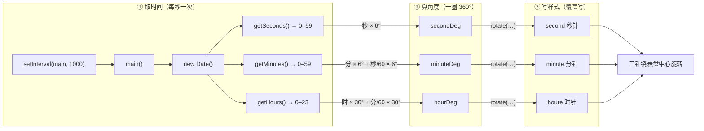

---
tags:
  - 前端/JavaScript
  - 蓝桥云课
---

# 让时钟转起来：用 Date + transform 驱动三根指针

> [!info] 原题
> 蓝桥云课 · 让时钟转起来（题目 2156）
> 蓝桥杯大赛 Web 应用与开发
> [题目链接](https://www.lanqiao.cn/problems/2156/learning/?page=1&first_category_id=2&tags=CSS3&tag_relation=union)

> [!summary] 速记版
> ```js
> function main() {
>   const nowTime = new Date();
>   const nowHoure = nowTime.getHours();
>   const nowMinute = nowTime.getMinutes();
>   const nowSecond = nowTime.getSeconds();
>
>   const houreDeg = (nowMinute / 60) * 30;
>   const minuteDeg = (nowSecond / 60) * 6;
>   const secondDeg = nowSecond * 6;      // ← 要补的核心
>
>   oHoure.style.transform  = `rotate(${nowHoure * 30 + houreDeg}deg)`;
>   oMinute.style.transform = `rotate(${nowMinute * 6 + minuteDeg}deg)`;
>   oSecond.style.transform = `rotate(${secondDeg}deg)`;  // ← 要补的核心
> }
> main();                              // 先画一次，别等第一个 1s
> setInterval(main, 1000);             // 之后每秒重画
> ```
> - 秒针：`秒数 × 6°`——一圈 360°，60 格，每格 `360/60 = 6°`。
> - 分针：`分钟 × 6° + 秒/60 × 6°`——分针不是一下跳 6°，而是连续走。
> - 时针：`小时 × 30° + 分钟/60 × 30°`——一圈 12 小时，每小时 `360/12 = 30°`。
> - **每帧都用 `Date` 重新算绝对角度**，不是"在上一次基础上 +6"，所以不会累积误差。
> - `transform` 是**覆盖写**：`rotate(90deg)` 表示当前处于 90°，不是再转 90°。
> - 只改 `01/index.js`，HTML、CSS、id、class 一律不能动。

## 考察内容

- **`Date` 对象取时间**：`new Date()`、`getHours()` / `getMinutes()` / `getSeconds()` 的取值与刷新时机。
- **角度换算**：表盘 360°，按时/分/秒各自的刻度算角，含"整刻度 + 小数部分"的连续量。
- **`transform: rotate()` 的写回方式**：字符串拼接 / 模板字符串，覆盖而非叠加。
- **DOM 动态创建**：`createElement`、`setAttribute`、`classList`、`append`。
- **定时驱动**：`setInterval` 的第一次延迟，以及为什么要先手动调一次 `main()`。
- **绝对量 vs 增量**：为什么用"当前时间 → 角度"而不是"每帧 +6°"。
- **判分约定**：不改动既有代码、DOM 结构、id/class，只补 TODO。

## 一、题目给了什么

题目只要求改 `01/index.js`（`index.html` 用 `<script src="index.js" type="module">` 引入它；样式表是外部链接，不在压缩包里）。原始 `index.js`：

```js
const oHoure = document.createElement('div');
const oMinute = document.createElement('div');
const oSecond = document.createElement('div');
oHoure.setAttribute('id','houre');
oMinute.setAttribute('id','minute');
oSecond.setAttribute('id','second');
oHoure.classList = 'pointer';
oMinute.classList = 'pointer';
oSecond.classList = 'pointer';
try{
    document.querySelector('.container').append(oHoure);
    document.querySelector('.container').append(oMinute);
    document.querySelector('.container').append(oSecond);
}catch(e){}

function main() {
    const nowTime=new Date();
    const nowHoure=nowTime.getHours();
    const nowMinute=nowTime.getMinutes();
    const nowSecond=nowTime.getSeconds();
    const houreDeg=(nowMinute/60)*30;
    const minuteDeg=(nowSecond/60)*6;

    oHoure.style.transform="rotate("+ (nowHoure * 30+houreDeg) + "deg)";
    oMinute.style.transform="rotate("+ (nowMinute * 6+ minuteDeg) + "deg)";
    // 请勿删除上方代码
    // 请在下方补充代码，使得时钟的秒针可以转动起来

}
main();

setInterval(() => {
    main()
}, 1000);
```

需要补的就是秒针那两步（放在 `main()` 里那两行注释的下方）：

```js
function main() {
    // ……… 上方原有代码保持不变 ………

    const secondDeg = nowSecond * 6;                     // ① 当前秒数换算成角度
    oSecond.style.transform = `rotate(${secondDeg}deg)`; // ② 写到秒针的内联样式上
}
```

等价的写法（官方参考解风格，不要中间变量）：

```js
oSecond.style.transform = "rotate(" + nowSecond * 6 + "deg)";
```

> [!danger] 只抄第 ② 行会失败
> `secondDeg` 的定义在 ① 行。如果只把 ② 行粘进去，`secondDeg` 是 `undefined`，最终字符串变成 `rotate(undefineddeg)`——CSS 判定非法、**静默丢弃**，控制台不报错，秒针一动不动。两行要么一起抄，要么用上面那条内联写法。

> [!note] 模板字符串与字符串拼接完全等价
> `` `rotate(${secondDeg}deg)` `` 和 `"rotate(" + secondDeg + "deg)"` 生成的是同一个字符串。前者是 ES6 语法，现代浏览器原生支持；在 Obsidian 笔记里它只是普通文本，不会被解析。拼接写法里 `*` 的优先级高于 `+`，所以 `"rotate(" + nowSecond * 6 + "deg)"` 会先算乘法，结果正确。

## 二、实现原理拆解

先看整体数据流：一次 `main()` 执行，就是把「当前时间」翻译成「三根针的角度」，再写回 DOM。



三列分别对应三个动作：**取时间 → 算角度 → 写样式**，每条箭头的标签就是这一步的换算关系。几个结构上的要点：

- 三条链路**互相独立**：秒针只依赖秒数，分针依赖分+秒，时针依赖时+分；任一指针算错不会影响另外两根。
- 角度箭头都是**乘法**（比例换算），不是加法（累加步长）——这决定了定时器晚触发时结果仍然正确。
- 最后的 `rotate()` 是一次**覆盖**，箭头代表"这一帧的最终值"，不是"在上一帧基础上再转"。

下面按这个顺序逐段拆开。

### 1. 指针是 JS 造出来的：`createElement` + `classList`

HTML 里的 `.container` 是**空壳**，三根指针全部由 JS 生成：

| 步骤 | 代码 | 作用 |
| --- | --- | --- |
| 建元素 | `document.createElement('div')` | 创建游离的节点，此时还没进文档树 |
| 给 id | `setAttribute('id','second')` | 让 CSS 的 `#second` 选中它 |
| 给 class | `oSecond.classList = 'pointer'` | 让 `.pointer` 的定位、`transform-origin` 生效 |
| 挂载 | `container.append(oSecond)` | 插入 DOM，样式和布局此刻才生效 |

> [!note] `classList = 'pointer'` 为什么能赋值
> `classList` 是只读属性，但 WebIDL 上带 `[PutForwards=value]`，给它赋字符串会转发到 `classList.value`，等价于设置 `className`。现代 Chrome / Firefox / Safari 都支持（Firefox 的 `Element.webidl` 同样声明了 `[PutForwards=value]`），只有老版本 IE 不行。更常见的写法是 `oSecond.classList.add('pointer')`；题目源码用的是赋值写法，**照抄即可、别"优化"它**——动了已有代码可能判分失败。

原代码还包了 `try { ... } catch(e) {}`：`querySelector('.container')` 找不到会返回 `null`，对 `null.append` 会抛错；try/catch 把这种失败吞掉，避免整个脚本中断。这说明脚本的执行时机依赖 HTML 已解析——`type="module"` 的脚本本来就是**延迟执行**（等价 deferred），能保证 `.container` 已经存在。

### 2. 时间快照：`new Date()` 必须写在 `main` 里面

```js
const nowTime = new Date();          // 此刻的时间快照
const nowHoure = nowTime.getHours(); // 0 ~ 23
const nowMinute = nowTime.getMinutes(); // 0 ~ 59
const nowSecond = nowTime.getSeconds(); // 0 ~ 59
```

关键点：`new Date()` 写在 `main()` **函数体内部**，而不是顶部写成全局常量。

- 写在函数内：每次定时器调用都取一次"现在"，表盘跟着真实时间走。
- 写在函数外：时间被冻结在页面加载的那一秒，指针永远不动。

每次 `new Date()` 都是一个独立的时间快照，`getXxx()` 从内部时间戳现算、不会缓存。注意 `Date` 对象本身是**可变**的（有 `setHours` 之类的方法），这里只是"新建一次、只读一次"的用法。

### 3. 角度换算：表盘就是 360°

思路统一为：**"当前这一刻在整圈里占的比例 × 360°"**。

| 指针 | 一圈对应 | 一刻度 | 连续量公式 | 代入本题 |
| --- | --- | --- | --- | --- |
| 秒针 | 60 秒 | 360/60 = **6°** | `秒 × 6` | `nowSecond * 6` |
| 分针 | 60 分 | 360/60 = **6°** | `分 × 6 + 秒/60 × 6` | `nowMinute * 6 + (nowSecond/60)*6` |
| 时针 | 12 小时 | 360/12 = **30°** | `时 × 30 + 分/60 × 30` | `nowHoure * 30 + (nowMinute/60)*30` |

几点容易忽略的细节：

1. **为什么分针要加 `秒/60×6`、时针要加 `分/60×30`**：真实钟表的指针是连续的。13:30:30 时，分针已经走过 30.5 个刻度，不是停在 30 刻度上。题目给的 `houreDeg`、`minuteDeg` 就是这两个"小数部分"。
2. **秒针反而不用加毫秒**：`getSeconds()` 返回整数 0–59，秒针是"跳格走"，每秒跳一格正好 6°。想更平滑可以加 `getMilliseconds()/1000`，见第四节「可继续追问的点」。
3. **角度是"位置"，不是"步长"**：`nowSecond * 6` 是 0°–354° 的绝对位置。如果你写成 `+= 6`，窗口切后台、定时器被节流后就再也对不上真实时间。
4. **方向**：CSS 的 `rotate(正角)` 在屏幕上就是**顺时针**（y 轴向下），所以直接用正角度即可，不需要取负。题目要求的"顺时针 + 6deg"与此天然一致。

### 4. 写回样式：`transform` 是覆盖，不是叠加

```js
oSecond.style.transform = `rotate(${secondDeg}deg)`;
```

- `style.transform` 每次都是**整体替换**。这次写 `rotate(180deg)`，元素就处于 180°，无论上次是多少。
- 这也是"每帧重算绝对角度"能成立的原因：状态不存在于元素上，而存在于 `Date` 里。
- 59 秒（354°）到 0 秒（0°）时数值上"回绕"，但**没有过渡**，浏览器直接跳到 0°，屏幕上就是正常前进一格，不会倒转。
- 反过来要注意：如果给 `transform` 加了 `transition`，354°→0° 会被插值成"倒转 354°"。真想加平滑过渡，得改用单调递增的累积角度，而不是取模后的绝对角度。
- 指针能绕表盘中心转，靠的是 CSS 里的 `transform-origin`（`.pointer` 用 `transform-origin: 50% 90%` 把旋转基点定在指针靠近表盘中心的一端），JS 只负责给角度——**JS 算角、CSS 定点**，职责分开。

字符串两种写法等价：

```js
// 模板字符串（推荐，可读性好）
oSecond.style.transform = `rotate(${secondDeg}deg)`;
// 字符串拼接（与题目原有风格一致）
oSecond.style.transform = "rotate(" + secondDeg + "deg)";
```

> [!warning] 别省掉 `deg`
> 写 `rotate(180)` 是**非法值**，浏览器会直接丢弃这条声明，指针一动不动，而且控制台不报错——很容易卡半天。

### 5. 驱动：`setInterval` + 先手动调一次

```js
main();                                  // ① 立即画一次
setInterval(() => { main() }, 1000);     // ② 之后每 1 秒重画
```

顺序不能颠倒，理由有二：

1. **`setInterval` 的第一次回调要等满 1000ms**。如果只写定时器，页面加载后指针会"僵"一秒才出现正确角度。
2. 先调一次 = 首帧立刻正确，之后只负责"跟随"。

关于 1000ms 这个周期：

- 秒数每秒变一次，周期取 1000ms 是**最低成本**的匹配。取 500ms 会让每秒重绘两次（无收益），取 2000ms 会漏秒。
- 定时器并不保证准点，只保证"不早于"。浏览器在标签页后台会把定时器节流到 1s 甚至更长；磁盘繁忙时回调也会延后。
- 但**每帧都从 `Date` 重算**，所以即使回调晚了，画出来的也是正确角度，不会像累加式那样越来越偏。这是"绝对量"设计的最大好处。

> [!tip] 更稳的写法（考试不必用）
> 把下一帧对齐到"整秒边界"，避免固定周期带来的长期相位漂移：
> ```js
> function tick() {
>   main();
>   setTimeout(tick, 1000 - (Date.now() % 1000));
> }
> tick();
> ```

### 6. 判分视角

- 测评大概率读取 `#second` 的 `transform` / `getComputedStyle` 角度，验证：**每秒递增 6°、与当前秒数对应、方向为顺时针**。
- 因此**不要**用 CSS `animation` 或 `transition` 代替 JS 计算——计算样式里可能读不到你期望的瞬时值。
- 已有代码、`id`、`class`、DOM 结构一律不动；题目只留了两行注释夹出的空白区。

## 三、易错点清单

| 错误写法 | 后果 | 正确做法 |
| --- | --- | --- |
| `oSecond.style.transform += " rotate(6deg)"` | 角度字符串越拼越长，不是每次 +6° | 每次都写完整角度，覆盖旧的 |
| `secondDeg += 6` 累加 | 定时器延迟后与真实时间脱节 | `nowSecond * 6` 每次重算 |
| 忘了 `deg` 单位 | 声明被丢弃，指针不动且无报错 | `rotate(180deg)` |
| 把 `new Date()` 提到函数外 | 时间冻结，指针不动 | 放在 `main()` 内部 |
| 只写 `setInterval`，不先 `main()` | 首秒空白/错位 | 先 `main();` 再定时 |
| 改了 `classList = 'pointer'` 为其他写法 | 可能被判"改动已有代码" | 只补空白区 |
| 用 `setInterval(main(), 1000)` | `main()` 先立即执行，返回值 `undefined` 被当作回调，之后每秒调用 `undefined`，实际只画一次 | 传函数引用 `main` / 箭头函数 |
| 只抄 `oSecond.style.transform = ...`，漏掉 `const secondDeg` 声明 | 得到 `rotate(undefineddeg)`，非法值被静默丢弃，秒针不动 | 两行一起抄，或内联 `nowSecond * 6` |
| 秒针乘 30（按小时刻度算） | 角度差 5 倍，转速不对 | 60 格用 6° |

## 四、可继续追问的点

- **平滑秒针**：`secondDeg = (nowSecond + nowTime.getMilliseconds() / 1000) * 6`，配合 16ms 的 `requestAnimationFrame` 循环，指针连续扫动。
- **时针更精确**：加上秒的贡献 `+ nowSecond / 3600 * 30`（每秒 0.0083°，肉眼几乎不可见）。
- **纯 CSS 方案对比**：`@keyframes` + `animation: rotate 60s linear infinite` 能让秒针自转，但它无法"对齐当前时间"——页面打开的瞬间只能从 0° 开始，需要 JS 额外写 `animation-delay` 反推偏移。JS 方案胜在随时可校准。
- **时钟校准**：`Date` 取的是本机时间，与时区/系统时钟一致；做"网络时钟"需要服务端时间戳来校正。
- **`transform` 与 `left/top` 的性能差异**：`transform` 只触发合成，不引起重排，适合高频动画；改 `left/top` 每帧都会重排。

## 参考

- [【Html.js——功能实现】让时钟转起来（蓝桥杯真题-2156）](https://cloud.tencent.com.cn/developer/article/2491502)
- [web蓝桥杯真题--5、让时钟转起来](https://blog.csdn.net/m0_65380423/article/details/135589482)
- [蓝桥杯 Web 赛道笔记（知乎）](https://zhuanlan.zhihu.com/p/610835905)
